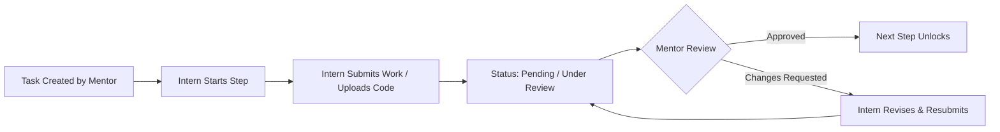

# Backend Integration Specification & Guide

This document describes how to connect the **Loyanox Mentor & Intern Management Platform** with a real backend (Node.js/Express, NestJS, Python/FastAPI/Django, Go, Spring Boot, Supabase, or Firebase).

---

## 1. Environment Configuration

Add the base URL of your API to `.env.local`:

```bash
NEXT_PUBLIC_API_URL=http://localhost:5000/api
```

The frontend uses the API client at `src/lib/api/client.js`, which automatically injects:
- `Content-Type: application/json`
- `Authorization: Bearer <jwt_token>` (retrieved from client storage)

---

## 2. Authentication Architecture

### Endpoints

| Method | Endpoint | Description | Request Body | Response (200) |
|---|---|---|---|---|
| `POST` | `/api/auth/login` | Sign in intern or mentor | `{ email, password, remember }` | `{ user: { id, name, email, role }, token }` |
| `POST` | `/api/auth/register` | Register new account | `{ name, email, password, role }` | `{ user: { id, name, email, role }, token }` |
| `POST` | `/api/auth/logout` | Revoke session | `{}` | `204 No Content` |
| `GET` | `/api/auth/me` | Current user profile | *(Bearer Token)* | `{ id, name, email, role, avatarUrl, department }` |
| `PUT` | `/api/auth/profile` | Update profile info | `{ name, email, bio, ... }` | `{ user, message }` |

---

## 3. Tasks & Deliverables Workflow

The platform links **Tasks** sequentially with **Submissions**:



### Endpoints

| Method | Endpoint | Description | Request Body |
|---|---|---|---|
| `GET` | `/api/tasks` | Get list of assigned tasks | Query params: `?status=all&project=...` |
| `GET` | `/api/tasks/:id` | Get task with subtasks/steps | — |
| `POST` | `/api/tasks/:id/steps/:stepId/complete` | Intern marks step done | `{}` |
| `POST` | `/api/tasks/:id/steps/:stepId/approve` | Mentor approves step | `{ notes: "Approved" }` |
| `GET` | `/api/submissions` | Get deliverables & reviews | Query params: `?status=...&type=...` |
| `POST` | `/api/submissions` | Submit work for review | `{ taskId, stepId, title, type, link, notes, files }` |
| `POST` | `/api/submissions/:id/revisions` | Submit revision | `{ changeNote, files, link, notes }` |
| `POST` | `/api/submissions/:id/withdraw` | Withdraw from review | `{}` |

---

## 4. Projects & Collaboration Endpoints

| Method | Endpoint | Description | Request Body |
|---|---|---|---|
| `GET` | `/api/projects` | Get all projects | — |
| `GET` | `/api/projects/:id` | Get project milestones & docs | — |
| `POST` | `/api/projects/:id/request-review` | Request supervisor review | `{ mentorName, note }` |
| `POST` | `/api/projects/:id/meetings` | Schedule 1-on-1 meeting | `{ mentorName, date, timeSlot, agenda }` |
| `POST` | `/api/projects/:id/resources` | Upload project resource/spec | `{ name, category, fileUrl, size }` |

---

## 5. Mentor Feedback Endpoints

| Method | Endpoint | Description | Request Body |
|---|---|---|---|
| `GET` | `/api/feedback` | Get feedback list | Query params: `?category=...&status=...` |
| `POST` | `/api/feedback/request` | Intern requests feedback | `{ mentor, subject, message, projectId, taskId }` |
| `PATCH` | `/api/feedback/:id/status` | Update feedback item status | `{ status: "Resolved" }` |

---

## 6. Notifications Endpoints

| Method | Endpoint | Description |
|---|---|---|
| `GET` | `/api/notifications` | Get notifications list |
| `PATCH` | `/api/notifications/:id/toggle-read` | Toggle read/unread status |
| `POST` | `/api/notifications/mark-all-read` | Mark all notifications as read |
| `DELETE` | `/api/notifications/:id` | Delete notification |
| `DELETE` | `/api/notifications/clear-all` | Clear all notifications |

---

## 7. Database Schemas (Recommended)

### User
```typescript
interface User {
  id: string;
  name: string;
  email: string;
  passwordHash: string;
  role: "intern" | "mentor" | "admin";
  avatarUrl?: string;
  department?: string;
  createdAt: Date;
}
```

### Task
```typescript
interface Task {
  id: string;
  title: string;
  project: string;
  internId: string;
  mentorId: string;
  status: "To do" | "In progress" | "Done";
  due: string;
  overdue: boolean;
  subtasks: {
    id: string;
    text: string;
    done: boolean;
    approved: boolean;
    submissionId?: string;
  }[];
}
```

### Submission
```typescript
interface Submission {
  id: string;
  title: string;
  type: "Source Code" | "Documentation" | "Design Artifacts" | "QA & Testing";
  taskId?: string;
  stepId?: string;
  status: "Pending" | "Approved" | "Changes Requested" | "Withdrawn";
  version: string; // e.g. "v1.0.0"
  files: string[];
  githubUrl?: string;
  link?: string;
  notes?: string;
  feedback?: string;
  versions: {
    version: string;
    date: string;
    status: string;
    changes: string;
  }[];
}
```
